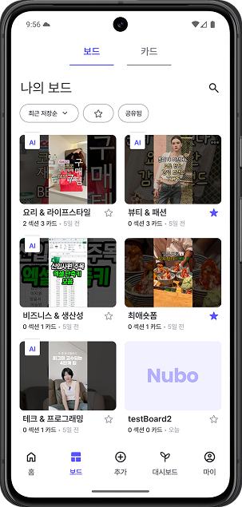
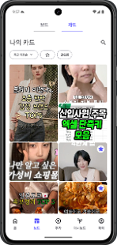
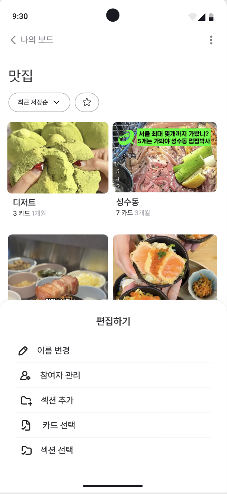
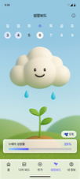
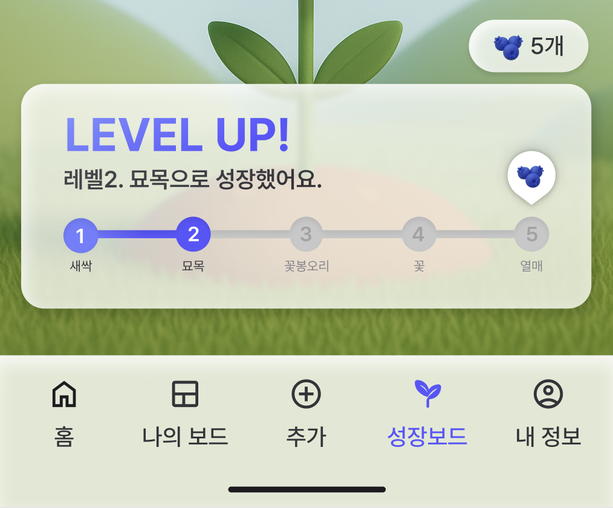
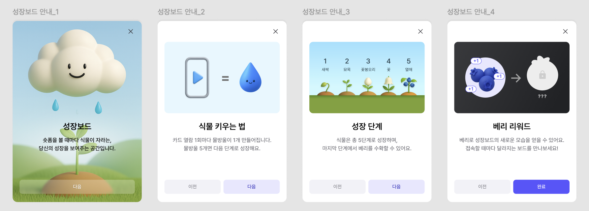
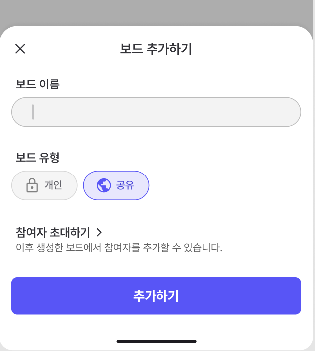
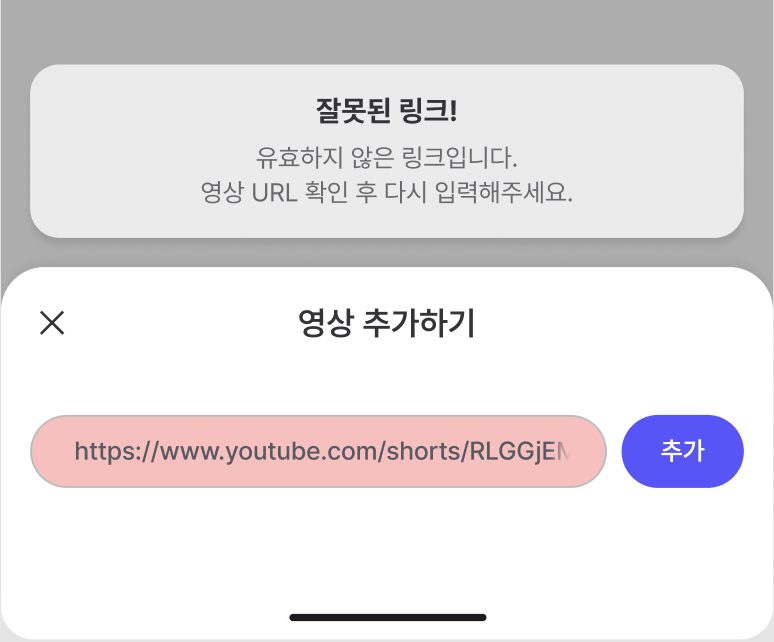

# 🌱 Nubo (누보)

### 숏폼 콘텐츠를 지식 자산으로 전환하는 AI 기반 Android 학습 서비스

Nubo는 자기계발형 숏폼 소비자를 위한 AI 기반 지식 저장소입니다.

숏폼 영상에서 발견한 유용한 정보를 AI로 요약하고, 주제별로 분류하여 개인 지식 보드에 저장할 수 있습니다.

또한 학습 활동을 성장보드로 시각화하여, 일회성 콘텐츠 소비가 지속적인 학습으로 이어지도록 돕습니다.

---


### Project Information

| 항목 | 내용 |
|---|---|
| 프로젝트 | 졸업프로젝트 2 · Nubo |
| 개발 기간 | 2025.03 – 2025.12 |
| 팀 구성 | 4명 |
| 담당 역할 | Android Frontend Development · Service Planning |

**My Contributions**
- MyBoard: 보드·카드 관리 및 공유보드 UI
- Learn: 성장보드, 레벨업 UI 및 온보딩
- Bottom Sheet: 영상 URL 추가 및 보드 생성
- Profile: 사용자 정보 및 설정 관련 기능
- 서비스 기획 및 사용자 조사 참여
- 일부 화면 디자인 참여

**Team Contributions**
- 다른 Android 개발자: 요약 카드 내부 기능 및 영상 업로드 관련 포그라운드 서비스
- AI·서버 영역: 콘텐츠 요약·자동 분류 및 서버 기능
- 디자인 영역: 3D·2D 그래픽 에셋 제작

※ 팀 전체 기능과 개인 구현 범위를 구분하여 작성했습니다.

---


## 🔍 Problem & Research


### 저장은 하지만, 다시 활용하지 못하는 숏폼 콘텐츠

Nubo 팀은 숏폼 콘텐츠의 저장과 활용 과정에서 발생하는 문제를 파악하기 위해 약 110명을 대상으로 사용자 설문조사를 진행했습니다.

### 📊 User Research

| 설문 결과 | 주요 발견 |
|---|---|
| **86.2%** | 숏폼 콘텐츠를 저장한 경험이 있음 |
| **70.6%** | 저장한 정보를 시간이 지나면 기억하지 못함 |
| **45.0%** | 저장한 콘텐츠가 흩어져 있어 다시 찾기 어려움 |
| **30.3%** | 숏폼 시청 후 학습이나 업무에 적용한 경험이 있음 |

*조사 기간: 03.25 ~ 04.08 / 응답자 약 110명*

### 💡 Problem Definition

사용자 조사와 인터뷰를 통해 세 가지 핵심 문제를 발견했습니다.

1. **정보의 분산** — 여러 플랫폼에 저장한 콘텐츠를 한곳에서 관리하기 어려움
2. **정리의 번거로움** — 영상의 핵심 내용을 직접 정리해야 하는 부담
3. **학습의 단절** — 저장한 정보를 다시 활용하거나 복습하기 어려움

Nubo는 이러한 문제를 해결하기 위해 **저장 → 분류 → 학습**으로 이어지는 지식 관리 서비스를 기획했습니다.

---

## 💡 Solution

### 저장에서 끝나지 않고, 학습으로 이어지는 경험

Nubo는 저장한 숏폼 콘텐츠를 사용자가 다시 찾고 활용할 수 있도록 **저장 → 분류 → 학습 → 추천**으로 이어지는 서비스 흐름을 설계했습니다.

| 핵심 기능 | 해결하고자 한 문제 | 제공 기능 |
|---|---|---|
| **AI 기반 영상 요약** | 영상 내용을 다시 확인해야 하는 번거로움 | STT 및 AI를 활용한 핵심 내용 요약 |
| **자동 분류 및 MyBoard** | 여러 플랫폼에 흩어진 콘텐츠 관리의 어려움 | 주제별 자동 분류 및 개인 지식 보드 |
| **성장보드(Learn)** | 학습 활동을 지속하기 어려움 | 학습 현황을 식물 성장으로 시각화 |
| **관심사 기반 추천** | 저장 이후 새로운 학습으로 연결되기 어려움 | 사용자 관심사에 맞는 콘텐츠 추천 |

이러한 기능을 통해 숏폼 콘텐츠를 단순히 보관하는 것이 아니라, **필요할 때 다시 찾아보고 지속적으로 활용할 수 있는 지식 자산**으로 전환하고자 했습니다.

---


## 👩‍💻 My Contributions


**Role: Android Frontend Developer / Service Planning**

서비스 기획 및 사용자 조사 과정에 참여했으며, Android Frontend 개발에서는 **MyBoard, 성장보드(Learn), 영상 추가 및 보드 생성 UI**를 중심으로 담당했습니다.


### 01. MyBoard — 개인 지식 관리

사용자가 저장한 숏폼 콘텐츠를 주제별로 확인하고 관리할 수 있도록 개인 지식 보드 화면을 구현했습니다.

**주요 구현 내용**

- Jetpack Compose를 활용한 보드 목록 및 상세 화면 UI 구성
- 보드 내 섹션과 카드의 선택·관리 인터랙션 구현
- ViewModel과 API 연동을 통한 보드 및 카드 데이터 조회
- 사용자 작업 결과와 오류 상황을 안내하는 Toast UI 처리
- Bottom Sheet를 활용한 콘텐츠 관리 기능 연결

**구현 과정에서 고려한 점**

보드, 섹션, 카드 등 여러 관리 대상이 존재하기 때문에 사용자가 현재 어떤 항목을 선택하고 있는지 명확하게 인지할 수 있도록 UI 상태를 구분했습니다.

특히 섹션과 카드를 동시에 선택하지 않도록 선택 가능한 항목을 시각적으로 구분하고, 허용되지 않는 선택에는 안내 메시지를 제공하여 사용자의 혼란을 줄이고자 했습니다.

또한 ViewModel을 통해 서버 데이터와 UI 상태를 관리하고, API 요청 결과에 따른 화면 피드백을 처리했습니다.

**관련 코드**

- `ui/screen/myBoard/MyBoardScreen.kt`
- `ui/screen/myBoard/BoardDetailScreen.kt`
- `ui/screen/myBoard/BoardDetailViewModel.kt`
- `ui/screen/myBoard/BoardViewModel.kt`


<p align="center">
  
  
  
</p>

<p align="center"><sub>Android 에뮬레이터 실행 화면 — 보드 목록 / 카드 목록 / Figma 디자인 시안 — 보드 상세 및 편집 메뉴 (Android 구현)</sub></p>


### 02. Learn — 학습 활동 시각화

사용자의 학습 활동을 식물의 성장 과정으로 표현하여, 콘텐츠 저장과 학습이 지속적인 성장 경험으로 이어지도록 돕는 **성장보드 화면**을 구현했습니다.

**주요 구현 내용**

- **Jetpack Compose 기반 UI 구현:** 구름, 식물, 성장 상태 등 그래픽 요소를 조합한 성장보드 화면 구성
- **학습 데이터 연동:** ViewModel과 API를 활용하여 학습 현황과 성장 상태를 화면에 반영
- **날짜별 학습 현황 표시:** 주간 캘린더와 학습 기록을 연결하여 날짜별 활동 확인
- **사용자 인터랙션 구현:** 날짜 선택 및 학습 현황에 따른 UI 변화 처리
- **오류 상태 처리:** 데이터 조회 실패 시 대체 UI와 사용자 안내 Toast 제공

**구현 과정에서 고려한 점**

성장보드는 단순히 학습 횟수를 숫자로 표시하는 것이 아니라, 사용자가 자신의 학습 활동을 직관적으로 인식하도록 설계된 화면입니다.

이를 위해 학습 상태와 그래픽 표현을 연결하고, 식물 성장 단계를 시각적으로 구분하여 학습에 대한 피드백을 제공하고자 했습니다.

또한 모바일 환경에서 그래픽 리소스가 차지하는 용량을 고려해, 초기 3D 리소스를 여러 개의 2D 그래픽 레이어로 전환하면서 기존 성장 경험을 유지하는 방향으로 구현했습니다.

**관련 코드**

- `ui/screen/learn/LearnScreen.kt`
- `ui/screen/learn/LearnScreenBerry.kt`
- `ui/screen/learn/LearnScreenInformation.kt`
- `ui/screen/learn/LearnScreenNuberryGet.kt`


<p align="center">
  
  
</p>

<p align="center"><sub>Figma 디자인 시안 — 성장보드 및 레벨업 UI (Android 구현)</sub></p>

<p align="center">
  
</p>

<p align="center"><sub>Figma 디자인 시안 — 성장보드 온보딩 (Android 구현)</sub></p>


### 03. Bottom Sheet — 영상 추가 및 보드 생성

사용자가 숏폼 콘텐츠를 저장하고 개인 지식 보드를 생성하는 과정을 지원하기 위해 **Bottom Sheet 기반 입력 UI**를 구현했습니다.

**주요 구현 내용**

- Jetpack Compose를 활용한 영상 URL 추가 및 신규 보드 생성 Bottom Sheet 구성
- 사용자 입력값과 선택 상태에 따른 UI 변경 처리
- 입력 결과를 ViewModel 및 API 연동 흐름에 전달
- 서비스 디자인 시스템에 맞춘 공통 UI 요소와 사용자 피드백 구성

**구현 과정에서 고려한 점**

영상 추가와 보드 생성은 사용자가 Nubo에 콘텐츠를 축적하는 시작점이므로, 별도의 화면으로 이동하지 않고 현재 화면의 맥락을 유지하면서 작업할 수 있도록 Bottom Sheet를 활용했습니다.

또한 사용자의 입력 상태에 따라 UI가 자연스럽게 반응하도록 구성하고, 저장 및 생성 과정이 기존 콘텐츠 관리 흐름과 연결되도록 구현했습니다.

**관련 코드**

- `ui/component/sheet/AddVideoSheet.kt`
- `ui/component/sheet/CreateBoardSheet.kt`


<p align="center">
  
  
</p>

<p align="center"><sub>Figma 디자인 시안 — 보드 생성 및 영상 URL 입력 오류 처리 (Android 구현)</sub></p>


### 04. Profile — 사용자 정보 및 설정

사용자 정보 확인과 계정 설정을 위한 마이페이지 및 관련 화면을 구현했습니다.

**주요 구현 내용**

- Jetpack Compose를 활용한 마이페이지, 내 정보, 닉네임 수정 화면 구성
- ViewModel과 API 연동을 통한 프로필 정보 조회 및 닉네임 변경 처리
- 전체 알림 및 미시청 카드 리마인드 설정 UI 구현
- 로그아웃 및 회원 탈퇴 처리 로직 연결
- 도움말 FAQ 및 개인정보 처리방침 안내 화면 구성

프로필 정보와 알림 설정 상태는 ViewModel에서 관리하고, 사용자 입력 및 API 요청 결과에 따라 화면 상태가 변경되도록 구현했습니다.

일부 부가 기능과 예외 처리에는 추가 보완이 필요한 상태로, 주요 개발 기능과 구분하여 소개합니다.

**관련 코드**

- `ui/screen/profile/ProfileScreen.kt`
- `ui/screen/profile/ProfileViewModel.kt`
- `ui/screen/profile/InformationScreen.kt`
- `ui/screen/profile/NotificationSetScreen.kt`


---


---

## 🛠️ Technical Challenges

### 01. 3D → 2D 그래픽 전환

**Problem**

디자인팀에서 전달받은 148.6MB의 GLB 파일을 SceneView로 렌더링하는 과정에서 로딩 지연과 렌더링 오류가 발생했습니다. 2일 이상 구현 방식과 설정을 수정했지만 문제가 해결되지 않았습니다.

**Solution**

프로젝트 일정과 모바일 사용성을 고려해 2D 그래픽으로 전환하는 방안을 제안했습니다.

디자인팀이 제작한 2D 에셋을 활용하여 Jetpack Compose의 `Box`와 `zIndex`로 그래픽 요소의 위치와 겹침을 조정하고, 성장 애니메이션과 터치 인터랙션을 구현했습니다.

또한 에뮬레이터 구현 영상과 직접 시연을 통해 디자이너와 결과물을 확인하며 시각적 경험을 조율했습니다.

**Result**

- 그래픽 리소스 크기 **148.6MB → 약 5MB (약 96.6% 감소)**
- 3D의 입체감을 유지하는 방향으로 성장보드 UI 구현
- 로컬 2D 리소스를 활용하는 구조로 전환

※ 감소 수치는 그래픽 리소스 기준이며, 앱 전체 용량이나 실행 성능의 개선율은 아닙니다.

### 02. 공유보드 권한에 따른 UI 동작 분리

**Problem**

공유보드에서 소유자와 카드 작성자별 권한 기준이 명확하지 않아, 사용자에게 표시되는 메뉴와 실제 수행 가능한 작업 사이에 불일치가 발생했습니다.

**Solution**

팀원들과 권한 기준을 논의하고, 사용자 역할에 따라 허용되는 작업을 구분했습니다.

- 보드 소유자(`owner`) 여부에 따라 관리 메뉴 및 작업 권한 분기
- 카드 작성자(`mine`) 여부에 따라 카드 선택과 관리 가능 여부 분기
- 선택할 수 없는 항목에는 오버레이를 적용하여 시각적으로 구분
- 허용되지 않은 작업을 시도할 경우 안내 토스트 제공

**Result**

사용자별 권한을 UI에 반영하여 수행할 수 없는 작업을 사전에 구분하고, 공유보드에서의 선택 및 관리 동작을 보다 일관되게 처리했습니다.

이 과정에서 권한을 단순히 화면에서 숨기는 문제가 아니라, **정해진 권한 정책을 사용자 인터랙션에 일관되게 반영해야 하는 문제**로 접근했습니다.

※ 클라이언트 UI의 권한 분기 경험이며, 서버 측 접근 제어를 직접 구현했다는 의미는 아닙니다.

### 03. 인증정보 노출 위험을 줄이기 위한 로그 개선

**Problem**

Android 앱 개발 과정에서 API 요청과 인증 상태를 확인하기 위해 사용한 디버깅 로그에 Access Token 등 민감한 인증정보가 출력될 가능성이 있었습니다.

인증정보가 로그에 남으면 개발 및 디버깅 과정에서 불필요한 정보 노출 위험이 발생할 수 있다고 판단했습니다.

**Solution**

포트폴리오용 코드를 정리하면서 인증 관련 로그와 네트워크 설정을 점검했습니다.

- 인증 토큰 등 민감한 정보를 직접 출력하는 로그 제거
- 디버깅에 필요한 정보와 노출되어서는 안 되는 인증정보 구분
- API 주소와 로컬 환경 설정을 분리하고 민감한 설정 파일의 Git 추적 여부 확인

**Result**

인증정보가 불필요하게 로그에 출력되는 경로를 줄이고, 공개 저장소에서 관리할 코드와 로컬 환경 설정을 구분했습니다.

이를 통해 정상적인 기능 구현뿐 아니라 **개발 과정에서 발생할 수 있는 보안 위험을 점검하는 습관**의 중요성을 배웠습니다.

※ 인증 시스템 전체를 구현하거나 보안 취약점 검증을 완료한 것은 아니며, 직접 수행한 로그 및 환경 설정 정리 작업을 중심으로 작성했습니다.

---


## ⚙️ Tech Stack & Architecture

### Tech Stack

| Category | Technology | Usage |
|---|---|---|
| Language | Kotlin | Android 애플리케이션 개발 |
| UI | Jetpack Compose, Material 3 | 선언형 UI 및 사용자 인터랙션 구현 |
| Architecture | MVVM | UI와 비즈니스 로직 분리 |
| Dependency Injection | Hilt | ViewModel 및 Repository 의존성 주입 |
| Networking | Retrofit, OkHttp | REST API 통신 |
| Asynchronous | Kotlin Coroutines, Flow | 비동기 작업 및 UI 상태 관리 |
| Navigation | Jetpack Navigation | 화면 간 이동 및 데이터 전달 |
| Image Loading | Coil | 네트워크 이미지 로딩 |
| Push Notification | Firebase Cloud Messaging | 푸시 알림 관련 기능 연동 |

### Architecture

Nubo Android 앱은 **MVVM 패턴을 기반으로 화면, 상태 관리, 데이터 접근 역할을 분리**했습니다.

```text
Jetpack Compose UI
        ↕
     ViewModel
        ↓
     Repository
        ↓
   Retrofit / API
        ↕
   Backend Server
```

**주요 설계 방식**

- **UI:** Jetpack Compose를 활용하여 화면을 선언적으로 구성하고 상태 변화에 따라 UI 갱신
- **ViewModel:** 화면에 필요한 데이터와 사용자 액션에 따른 상태 변화 관리
- **Repository:** 서버 통신 및 데이터 접근 로직 분리
- **Coroutines & Flow:** 비동기 API 요청과 상태 스트림 처리
- **Hilt:** 의존성 주입을 통한 컴포넌트 간 결합도 관리

특히 MyBoard와 Profile에서는 API 응답에 따른 화면 상태를 ViewModel에서 관리하고, Compose UI가 이를 구독하여 화면에 반영하도록 구성했습니다.


### Development Scope

위 기술 스택은 **Android 팀 프로젝트 전체에서 사용한 기술**을 기준으로 작성했습니다.

개인적으로는 Kotlin, Jetpack Compose, ViewModel, Coroutines 및 API 연동을 중심으로 개발했습니다.

FCM 기반 푸시 알림 시스템과 영상 업로드 관련 포그라운드 서비스는 다른 Android 팀원이 주요 구현을 담당했습니다. 저는 프로필 영역의 알림 설정과 로그아웃 시 FCM 토큰 정리 관련 클라이언트 로직을 다뤘습니다.

※ 위 아키텍처 다이어그램은 주요 화면의 데이터 흐름을 단순화한 것으로, 모든 화면이 동일한 구조로 구현되었다는 의미는 아닙니다.

---

## ⚠️ Limitations

Nubo는 캡스톤디자인 프로젝트로 개발되었으며, **정식 서비스로 출시하지 않았습니다.**

외부 플랫폼의 영상 정보를 가져오는 과정에서 영상 추출 도구의 잦은 업데이트로 인한 서버 유지보수 부담이 발생했습니다.

또한 외부 플랫폼의 콘텐츠를 활용하는 서비스 특성상 이용약관 및 저작권 관련 검토가 필요하다는 한계가 있었습니다.

이러한 이유로 정식 서비스 운영까지 이어지지는 않았습니다.

---

## 🚀 How to Run

현재 백엔드 서버 운영이 종료되어 **앱의 전체 기능을 정상적으로 실행하기 어렵습니다.**

- Android 소스코드는 저장소에서 확인할 수 있습니다.
- 실제 API 서버 주소, 인증 키 및 로컬 환경 설정 파일은 공개 저장소에 포함하지 않았습니다.
- 주요 구현 기능은 README의 화면 자료와 관련 소스코드를 통해 확인할 수 있습니다.

본 저장소는 실제 서비스 배포용이 아닌, 개인의 Android 개발 기여 및 기술적 문제 해결 과정을 소개하기 위한 포트폴리오입니다.

---

## 🔗 Repository

- **Personal Portfolio:** [LeeYeso/nubo-portfolio](https://github.com/LeeYeso/nubo-portfolio)
- **Original Team Repository:** [2025SWU-Nubo/nubo-frontend](https://github.com/2025SWU-Nubo/nubo-frontend)

본 저장소는 팀 프로젝트의 기존 개발 이력을 기반으로 개인 포트폴리오 용도에 맞게 코드와 문서를 정리한 저장소입니다.

팀 전체의 서비스 개발 내용과 개인 담당 영역을 구분하여 소개했습니다.

